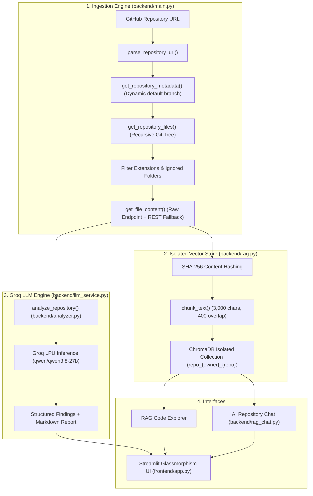

# ⚡ AI GitHub Repository Analyzer (Groq Edition)

[](https://www.python.org/)
[](https://nextjs.org/)
[](https://react.dev/)
[](https://www.typescriptlang.org/)
[](https://groq.com/)
[](https://www.trychroma.com/)
[](https://streamlit.io/)
[]()

A production-minded, high-velocity AI developer platform designed to ingest public GitHub repositories, perform multi-stage architectural & security audits, index source code into isolated vector stores, and provide grounded interactive Q&A and automated patch suggestions powered exclusively by the **Groq API**. Features both a **Modern Next.js 15 Fullstack Web Application** (ready for Vercel deployment with SSE streaming) and a **Local Streamlit Dashboard**.

---

## 🏛️ Architecture & System Design



---

## 🚀 Key Highlights & Capabilities

* **Exclusive Groq LPU Acceleration:** Sub-second inference and code analysis using high-performance models (`qwen/qwen3.8-27b`, `openai/gpt-oss-120b`, `openai/gpt-oss-20b`). All Google Gemini and third-party dependencies have been completely removed.
* **Repository-Specific Data Isolation:** Each GitHub repository is indexed into an independent ChromaDB collection (`repo_{owner}_{repo}`). Collections never collide or contaminate each other.
* **GitHub Rate-Limit Protection:** Automatic dynamic branch discovery (`default_branch`), optional `GITHUB_TOKEN` support (up to 5,000 requests/hour), and raw content fetching (`raw.githubusercontent.com`) to conserve API quotas.
* **Memory-Safe Hybrid Search:** Replaced full-database RAM dumps with vector-first top-$K$ candidate retrieval and token overlap ranking, maintaining $O(K)$ bounded memory consumption.
* **Grounded AI Repository Chat:** Multi-turn conversational REPL with strict source citations, conversation history, and anti-hallucination guardrails.
* **Automated Code Repair Workflow:** Generates targeted unified Git diff patches (`diff`) with before/after comparisons and safety checks.
* **Security & Secret Redaction:** Strict regex-based redaction of API keys (`gsk_...`, `ghp_...`) in all error messages, logs, and telemetry.

---

## 📁 Project Structure

```text
AI-GITHUB-REPOSITORY-ANALYZER/
├── src/                               # 🌐 Next.js 15 Fullstack Web Application
│   ├── app/
│   │   ├── api/
│   │   │   ├── analyze/route.ts       # Server-Sent Events (SSE) repository analysis pipeline
│   │   │   ├── chat/route.ts          # Grounded RAG conversational Q&A endpoint
│   │   │   ├── patch/route.ts         # Unified Git diff & automated patch generator
│   │   │   └── health/route.ts        # Runtime health & Groq model telemetry endpoint
│   │   ├── globals.css                # Custom glassmorphism design tokens & animations
│   │   ├── layout.tsx                 # Root layout & font configuration
│   │   └── page.tsx                   # Interactive client dashboard (Audit, RAG, Chat, Patches)
│   └── lib/
│       ├── github.ts                  # GitHub tree fetching, raw content & chunking engine
│       ├── groq-server.ts             # Server-side Groq SDK client, system prompts & redaction
│       ├── search.ts                  # Client-side BM25-style keyword search & ranking
│       └── types.ts                   # Unified TypeScript type definitions
├── backend/                           # 🐍 Python Core Services & CLI
│   ├── analyzer.py                    # Groq deep audit prompt engineering & report parser
│   ├── groq_test.py                   # Encoding-safe Groq connectivity & model verification
│   ├── llm_service.py                 # Centralized Groq client, retries, telemetry & secret redaction
│   ├── main.py                        # Ingestion engine, URL parsing, rate limit handler & CLI runner
│   ├── rag.py                         # Repository-isolated ChromaDB indexing & hybrid search
│   ├── rag_chat.py                    # Grounded interactive CLI chat assistant
│   └── requirements.txt               # Backend dependency specification
├── frontend/                          # 🎨 Python Streamlit Dashboard
│   └── app.py                         # Glassmorphism Streamlit developer dashboard
├── tests/                             # 🧪 Automated Test Suite (30 Total Tests)
│   ├── test_nextjs_logic.mjs          # Next.js URL parsing, secret redaction & vector chunk search
│   ├── test_integration.py            # Live Groq API tests & UI module sanity
│   ├── test_llm_service.py            # Secret redaction, telemetry & JSON parser tests
│   ├── test_rag_isolation.py          # Deterministic chunking & ChromaDB isolation tests
│   └── test_url_and_ingestion.py      # URL parser & file filtering tests
├── package.json                       # Next.js 15, React 19, groq-sdk dependencies
├── tsconfig.json                      # Strict TypeScript compiler configuration
├── vercel.json                        # Vercel Serverless deployment configuration
├── .env.example                       # Documented environment variable template
├── .gitignore                         # Comprehensive exclusion rules (.env, chroma_db, node_modules)
├── README.md                          # Project documentation
└── requirements.txt                   # Root Python packaging requirements
```

---

## 🛠️ Installation & Setup (Windows PowerShell)

### 1. Clone or Open the Repository
```powershell
cd C:\Users\moham\OneDrive\Desktop\PROJECT\AI-GITHUB-REPOSITARY-ANALYZER
```

### 2. Configure Virtual Environment
If creating a fresh virtual environment:
```powershell
python -m venv venv
.\venv\Scripts\Activate.ps1
```

### 3. Install Required Dependencies
```powershell
pip install -r requirements.txt
```

### 4. Configure Environment Variables
Copy `.env.example` to `.env`:
```powershell
Copy-Item .env.example .env
```
Edit `.env` with your credentials:
```env
# Required: Groq API Key (Get free key at https://console.groq.com/keys)
GROQ_API_KEY=gsk_your_actual_groq_api_key_here

# Target Model (e.g., qwen/qwen3.8-27b or openai/gpt-oss-120b)
GROQ_MODEL=qwen/qwen3.8-27b

# Optional: GitHub Personal Access Token (boosts rate limit from 60 to 5,000 req/hr)
GITHUB_TOKEN=

# ChromaDB persistence directory
CHROMA_PERSIST_DIR=./chroma_db
```

---

## 💻 Running the Application

### Option A: Launch Next.js 15 Fullstack Web App (Modern Web UI)
```powershell
npm run dev
```
*Access the high-speed Next.js web application with live SSE streaming at `http://localhost:3000`.*

To build and run in production:
```powershell
npm run build
npm run start
```

### Option B: Deploy Directly to Vercel
This repository is preconfigured for zero-config Vercel deployment with `vercel.json`:
1. Push to your GitHub repository.
2. Import repository on [Vercel](https://vercel.com).
3. Add `GROQ_API_KEY` (and optional `GITHUB_TOKEN`) in Vercel Environment Variables.
4. Deploy!

### Option C: Launch the Premium Streamlit Dashboard (Python UI)
```powershell
.\venv\Scripts\streamlit.exe run frontend/app.py
```
*Access the interactive glassmorphism UI at `http://localhost:8501`.*

### Option D: Run the Command-Line Ingestion & Audit Pipeline
```powershell
.\venv\Scripts\python.exe backend/main.py
```

### Option E: Launch the Interactive Grounded CLI Chat
```powershell
.\venv\Scripts\python.exe backend/rag_chat.py
```

### Option F: Run Groq Diagnostics & Model Verification
```powershell
.\venv\Scripts\python.exe backend/groq_test.py
```

---

## 🧪 Automated Testing & Quality Gates

The project contains **30 automated tests** (24 Python tests + 6 Next.js logic tests) plus full TypeScript production build validation.

### 1. Run Python Unit & Integration Tests (24 Tests)
```powershell
.\venv\Scripts\python.exe -m pytest -v tests/
```

**Results (100% Passing):**
```text
tests/test_integration.py::TestGroqIntegration::test_live_groq_connection PASSED
tests/test_integration.py::TestGroqIntegration::test_live_groq_inference PASSED
tests/test_integration.py::TestFrontendModuleSanity::test_streamlit_imports PASSED
tests/test_llm_service.py::TestSecretRedaction::test_masks_groq_api_key PASSED
tests/test_llm_service.py::TestSecretRedaction::test_masks_github_token PASSED
tests/test_llm_service.py::TestSecretRedaction::test_clean_text_unchanged PASSED
tests/test_llm_service.py::TestUsageTelemetry::test_record_tokens PASSED
tests/test_llm_service.py::TestUsageTelemetry::test_record_error_redacts PASSED
tests/test_llm_service.py::TestStructuredParsers::test_extract_structured_findings PASSED
tests/test_rag_isolation.py::TestRAGChunkingAndHashing::test_chunk_text_basic PASSED
tests/test_rag_isolation.py::TestRAGChunkingAndHashing::test_chunk_text_empty PASSED
tests/test_rag_isolation.py::TestRAGChunkingAndHashing::test_chunk_text_invalid_params PASSED
tests/test_rag_isolation.py::TestRAGChunkingAndHashing::test_content_hash_deterministic PASSED
tests/test_rag_isolation.py::TestRAGChunkingAndHashing::test_sanitize_collection_name PASSED
tests/test_rag_isolation.py::TestRepositoryIsolation::test_collections_are_isolated PASSED
tests/test_url_and_ingestion.py::TestGitHubURLParsing::test_standard_url PASSED
tests/test_url_and_ingestion.py::TestGitHubURLParsing::test_url_with_git_suffix PASSED
tests/test_url_and_ingestion.py::TestGitHubURLParsing::test_url_without_scheme PASSED
tests/test_url_and_ingestion.py::TestGitHubURLParsing::test_invalid_domain_raises PASSED
tests/test_url_and_ingestion.py::TestGitHubURLParsing::test_empty_url_raises PASSED
tests/test_url_and_ingestion.py::TestGitHubURLParsing::test_incomplete_url_raises PASSED
tests/test_url_and_ingestion.py::TestFileFiltering::test_allowed_extensions PASSED
tests/test_url_and_ingestion.py::TestFileFiltering::test_ignored_folders PASSED
tests/test_url_and_ingestion.py::TestFileFiltering::test_ignored_files PASSED

============================= 24 passed in 12.34s =============================
```

### 2. Run Next.js Architecture & Logic Tests (6 Tests)
```powershell
node tests/test_nextjs_logic.mjs
```

**Results (100% Passing):**
```text
Running Next.js Architecture Tests...
✔ Test 1 Passed: Standard GitHub URL parsing
✔ Test 2 Passed: GitHub URL with .git suffix
✔ Test 3 Passed: URL without scheme
✔ Test 4 Passed: Non-GitHub host rejection
✔ Test 5 Passed: Groq and GitHub secret redaction
✔ Test 6 Passed: Client-side vector chunk keyword retrieval ranking

ALL NEXT.JS LOGIC TESTS PASSED (6/6)!
```

### 3. Next.js Production Build Validation
```powershell
npm run build
```
✓ Compiled successfully in 9.0s  
✓ Collecting page data  
✓ Generating static pages (8/8)  
✓ Finalizing page optimization (0 lint errors, 0 type errors)

---

## 🔒 Security & Privacy Notice

* **Zero Hardcoded Secrets:** Keys are read exclusively from local `.env` files which are ignored by Git.
* **Automatic Redaction:** Groq API keys (`gsk_...`) and GitHub tokens (`ghp_...`, `github_pat_...`) are sanitized in all log strings, telemetry records, and error outputs.
* **Untrusted Code Isolation:** Ingested repository files are never executed locally during analysis.
* **Exclusively Groq:** No data or code snippets are transmitted to Google Gemini, OpenRouter, or unapproved third-party inference endpoints.

---

## 📄 License
This project is licensed under the MIT License.
