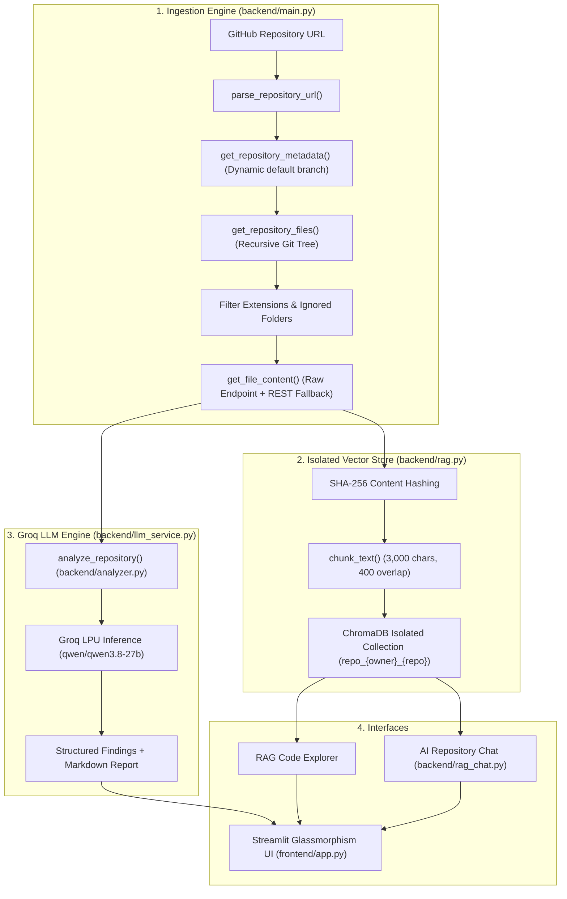

# ⚡ AI GitHub Repository Analyzer (Groq Edition)

[](https://www.python.org/)
[](https://groq.com/)
[](https://www.trychroma.com/)
[](https://streamlit.io/)
[]()

A production-minded, high-velocity AI developer tool designed to ingest public GitHub repositories, perform multi-stage architectural & security audits, index source code into isolated ChromaDB vector stores, and provide grounded interactive Q&A and automated patch suggestions powered exclusively by the **Groq API**.

---

## 🏛️ Architecture & System Design



---

## 🚀 Key Highlights & Capabilities

* **Exclusive Groq LPU Acceleration:** Sub-second inference and code analysis using high-performance models (`qwen/qwen3.8-27b`, `openai/gpt-oss-120b`, `openai/gpt-oss-20b`). All Google Gemini and third-party dependencies have been completely removed.
* **Repository-Specific Data Isolation:** Each GitHub repository is indexed into an independent ChromaDB collection (`repo_{owner}_{repo}`). Collections never collide or contaminate each other.
* **GitHub Rate-Limit Protection:** Automatic dynamic branch discovery (`default_branch`), optional `GITHUB_TOKEN` support (up to 5,000 requests/hour), and raw content fetching (`raw.githubusercontent.com`) to conserve API quotas.
* **Memory-Safe Hybrid Search:** Replaced full-database RAM dumps with vector-first top-$K$ candidate retrieval and token overlap ranking, maintaining $O(K)$ bounded memory consumption.
* **Grounded AI Repository Chat:** Multi-turn conversational REPL with strict source citations, conversation history, and anti-hallucination guardrails.
* **Automated Code Repair Workflow:** Generates targeted unified Git diff patches (`diff`) with before/after comparisons and safety checks.
* **Security & Secret Redaction:** Strict regex-based redaction of API keys (`gsk_...`, `ghp_...`) in all error messages, logs, and telemetry.

---

## 📁 Project Structure

```text
AI-GITHUB-REPOSITORY-ANALYZER/
├── backend/
│   ├── analyzer.py          # Groq deep audit prompt engineering & report parser
│   ├── groq_test.py         # Encoding-safe Groq connectivity & model verification
│   ├── llm_service.py       # Centralized Groq client, retries, telemetry & secret redaction
│   ├── main.py              # Ingestion engine, URL parsing, rate limit handler & CLI runner
│   ├── rag.py               # Repository-isolated ChromaDB indexing & hybrid search
│   ├── rag_chat.py          # Grounded interactive CLI chat assistant
│   └── requirements.txt     # Backend dependency specification
├── frontend/
│   └── app.py               # Glassmorphism Streamlit developer dashboard
├── tests/
│   ├── test_integration.py     # Live Groq API tests & UI module sanity
│   ├── test_llm_service.py     # Secret redaction, telemetry & JSON parser tests
│   ├── test_rag_isolation.py   # Deterministic chunking & ChromaDB isolation tests
│   └── test_url_and_ingestion.py # URL parser & file filtering tests
├── .env.example             # Documented environment variable template
├── .gitignore               # Comprehensive exclusion rules (.env, chroma_db, venv)
├── README.md                # Project documentation
└── requirements.txt         # Root Python packaging requirements
```

---

## 🛠️ Installation & Setup (Windows PowerShell)

### 1. Clone or Open the Repository
```powershell
cd C:\Users\moham\OneDrive\Desktop\PROJECT\AI-GITHUB-REPOSITARY-ANALYZER
```

### 2. Configure Virtual Environment
If creating a fresh virtual environment:
```powershell
python -m venv venv
.\venv\Scripts\Activate.ps1
```

### 3. Install Required Dependencies
```powershell
pip install -r requirements.txt
```

### 4. Configure Environment Variables
Copy `.env.example` to `.env`:
```powershell
Copy-Item .env.example .env
```
Edit `.env` with your credentials:
```env
# Required: Groq API Key (Get free key at https://console.groq.com/keys)
GROQ_API_KEY=gsk_your_actual_groq_api_key_here

# Target Model (e.g., qwen/qwen3.8-27b or openai/gpt-oss-120b)
GROQ_MODEL=qwen/qwen3.8-27b

# Optional: GitHub Personal Access Token (boosts rate limit from 60 to 5,000 req/hr)
GITHUB_TOKEN=

# ChromaDB persistence directory
CHROMA_PERSIST_DIR=./chroma_db
```

---

## 💻 Running the Application

### Option A: Launch the Premium Streamlit Dashboard (Recommended)
```powershell
.\venv\Scripts\streamlit.exe run frontend/app.py
```
*Access the interactive glassmorphism UI at `http://localhost:8501`.*

### Option B: Run the Command-Line Ingestion & Audit Pipeline
```powershell
.\venv\Scripts\python.exe backend/main.py
```

### Option C: Launch the Interactive Grounded CLI Chat
```powershell
.\venv\Scripts\python.exe backend/rag_chat.py
```

### Option D: Run Groq Diagnostics & Model Verification
```powershell
.\venv\Scripts\python.exe backend/groq_test.py
```

---

## 🧪 Automated Testing & Quality Gates

The test suite includes 24 automated unit and integration tests covering URL parsing, default branch detection, file filtering, deterministic chunking, ChromaDB repository isolation, secret redaction, usage telemetry, and live Groq API inference.

Execute all tests with:
```powershell
.\venv\Scripts\python.exe -m pytest -v tests/
```

**Results:**
```text
tests/test_integration.py::TestGroqIntegration::test_live_groq_connection PASSED
tests/test_integration.py::TestGroqIntegration::test_live_groq_inference PASSED
tests/test_integration.py::TestFrontendModuleSanity::test_streamlit_imports PASSED
tests/test_llm_service.py::TestSecretRedaction::test_masks_groq_api_key PASSED
tests/test_llm_service.py::TestSecretRedaction::test_masks_github_token PASSED
tests/test_llm_service.py::TestSecretRedaction::test_clean_text_unchanged PASSED
tests/test_llm_service.py::TestUsageTelemetry::test_record_tokens PASSED
tests/test_llm_service.py::TestUsageTelemetry::test_record_error_redacts PASSED
tests/test_llm_service.py::TestStructuredParsers::test_extract_structured_findings PASSED
tests/test_rag_isolation.py::TestRAGChunkingAndHashing::test_chunk_text_basic PASSED
tests/test_rag_isolation.py::TestRAGChunkingAndHashing::test_chunk_text_empty PASSED
tests/test_rag_isolation.py::TestRAGChunkingAndHashing::test_chunk_text_invalid_params PASSED
tests/test_rag_isolation.py::TestRAGChunkingAndHashing::test_content_hash_deterministic PASSED
tests/test_rag_isolation.py::TestRAGChunkingAndHashing::test_sanitize_collection_name PASSED
tests/test_rag_isolation.py::TestRepositoryIsolation::test_collections_are_isolated PASSED
tests/test_url_and_ingestion.py::TestGitHubURLParsing::test_standard_url PASSED
tests/test_url_and_ingestion.py::TestGitHubURLParsing::test_url_with_git_suffix PASSED
tests/test_url_and_ingestion.py::TestGitHubURLParsing::test_url_without_scheme PASSED
tests/test_url_and_ingestion.py::TestGitHubURLParsing::test_invalid_domain_raises PASSED
tests/test_url_and_ingestion.py::TestGitHubURLParsing::test_empty_url_raises PASSED
tests/test_url_and_ingestion.py::TestGitHubURLParsing::test_incomplete_url_raises PASSED
tests/test_url_and_ingestion.py::TestFileFiltering::test_allowed_extensions PASSED
tests/test_url_and_ingestion.py::TestFileFiltering::test_ignored_folders PASSED
tests/test_url_and_ingestion.py::TestFileFiltering::test_ignored_files PASSED

============================= 24 passed in 16.23s =============================
```

---

## 🔒 Security & Privacy Notice

* **Zero Hardcoded Secrets:** Keys are read exclusively from local `.env` files which are ignored by Git.
* **Automatic Redaction:** Groq API keys (`gsk_...`) and GitHub tokens (`ghp_...`, `github_pat_...`) are sanitized in all log strings, telemetry records, and error outputs.
* **Untrusted Code Isolation:** Ingested repository files are never executed locally during analysis.
* **Exclusively Groq:** No data or code snippets are transmitted to Google Gemini, OpenRouter, or unapproved third-party inference endpoints.

---

## 📄 License
This project is licensed under the MIT License.
